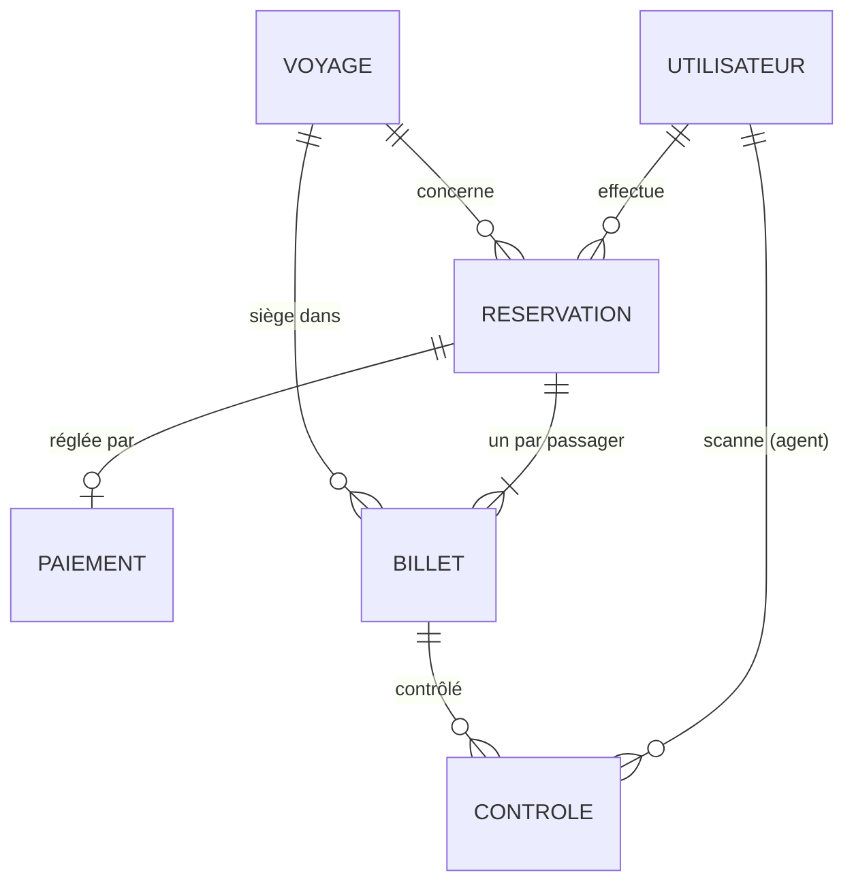
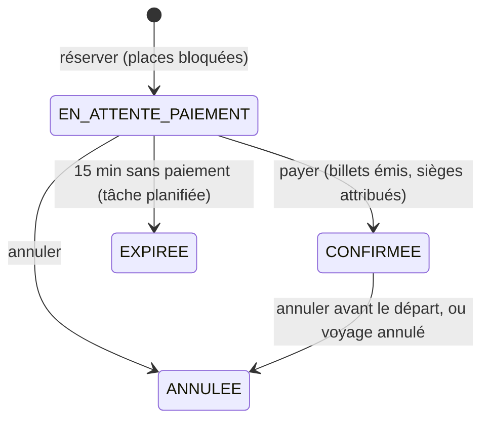
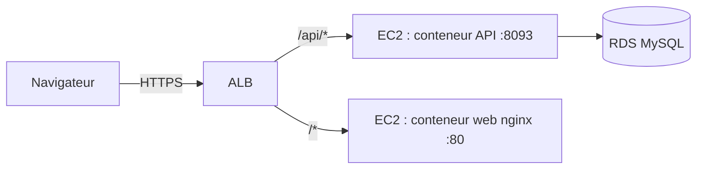

# Yoon : API de réservation de voyages en car au Sénégal

Backend Spring Boot de **Yoon**. Les voyageurs réservent une place sur les lignes interurbaines
(Dakar, Saint-Louis, Touba, Ziguinchor, Kaolack, Tambacounda…) et reçoivent un **billet à QR code signé**.
En gare, les agents de contrôle scannent le QR : le serveur vérifie la signature et le statut du billet,
puis enregistre l'embarquement. Un billet ne peut servir qu'une fois.

Le frontend Angular est dans le dépôt [GestionVoyageFrontend](https://github.com/kamoustaph/GestionVoyageFrontend).

## Sommaire

1. [Démarrage rapide](#démarrage-rapide)
2. [Fonctionnalités par rôle](#fonctionnalités-par-rôle)
3. [Architecture](#architecture)
4. [Le billet QR et son contrôle](#le-billet-qr-et-son-contrôle)
5. [API REST](#api-rest)
6. [Configuration](#configuration)
7. [Docker](#docker)
8. [Déploiement sur AWS](#déploiement-sur-aws)
9. [Tests et CI](#tests-et-ci)
10. [Sécurité](#sécurité)

## Démarrage rapide

Prérequis : Java 17 ou plus. Aucune base à installer : le profil par défaut utilise H2 en mémoire.

```bash
./mvnw spring-boot:run
```

- API : http://localhost:8093/api
- Documentation interactive (Swagger) : http://localhost:8093/swagger-ui.html
- Santé : http://localhost:8093/actuator/health

Au premier démarrage, des **données de démonstration** sont créées : environ 350 départs sur 14 jours,
et un départ dans 2 heures avec deux billets déjà payés, prêts à être scannés.

| Rôle | Email | Mot de passe |
|---|---|---|
| Administrateur | admin@yoon.sn | Admin123! |
| Agent de contrôle | agent@yoon.sn | Agent123! |
| Voyageur | voyageur@yoon.sn | Voyageur123! |

Les données H2 sont perdues à l'arrêt. Pour une base persistante, utilisez le profil `prod` (MySQL), voir [Configuration](#configuration).

## Fonctionnalités par rôle

**Visiteur (sans compte)**
- Rechercher des départs par ville de départ, d'arrivée et date.
- Voir les prochains départs (tableau d'affichage de la page d'accueil).
- Créer un compte voyageur.

**Voyageur**
- Réserver jusqu'à 6 places, une par passager nommé. Les places sont bloquées 15 minutes.
- Payer par Wave, Orange Money, Free Money ou carte (**paiement simulé**, voir plus bas).
- Recevoir un billet par passager, avec siège attribué et QR code signé.
- Consulter ses billets et réservations, annuler avant le départ (places libérées).

**Agent de contrôle**
- Scanner un QR (ou saisir le code imprimé) : verdict immédiat avec le nom du passager.
- Confirmer l'embarquement : le billet passe à `UTILISE`.
- Restreindre le contrôle à un départ précis : un billet d'un autre car est refusé.
- Consulter la liste d'embarquement d'un départ et son propre historique du jour.

**Administrateur**
- Tableau de bord : chiffre d'affaires, billets vendus et embarqués, remplissage, ventes sur 14 jours, lignes les plus vendues.
- Programmer, modifier, ouvrir à l'embarquement, marquer parti ou annuler un départ (l'annulation annule les billets).
- Gérer les comptes : créer des agents, changer un rôle, désactiver un compte.
- Journal de tous les contrôles (acceptés et refusés), pour repérer les tentatives de fraude.

## Architecture

```
src/main/java/moustapha/teach/gestionVoyage
├── GestionVoyageApplication.java   point d'entrée (planification activée)
├── config/                         AppProperties (app.*), OpenAPI, données de démo
├── security/                       JWT, filtre, règles d'accès par rôle
├── domain/                         entités JPA et énumérations
├── repository/                     Spring Data JPA
├── dto/                            objets échangés avec le frontend (records)
├── service/                        logique métier
└── web/                            contrôleurs REST et gestion des erreurs
```



Cycle de vie d'une réservation :



Points de conception :
- **Pas de survente** : `Voyage` porte un verrou optimiste (`@Version`). Deux réservations simultanées sur la dernière place : l'une reçoit `409 Conflict`.
- **Sièges** : attribués au paiement, plus petit numéro libre.
- **Expiration** : une tâche `@Scheduled` toutes les minutes rend les places des réservations non payées.
- **Erreurs** : toutes les erreurs ont le même format JSON `{status, message, champs, date}`, messages en français prêts à afficher.

## Le billet QR et son contrôle

Le QR code contient une chaîne courte, sans aucune donnée personnelle :

```
YOON1.<code du billet>.<signature>
ex. YOON1.8HKT3QZP2W.q3V0bJk1x7m9yH2cLw5tAg
```

La signature est un **HMAC-SHA256** (tronqué à 128 bits, base64url) du code, de l'identifiant du voyage et du numéro
de siège, calculé avec la clé secrète `QR_SECRET` connue du serveur seul (`service/QrSigner.java`). Conséquences :

- un QR inventé ou modifié est rejeté (`SIGNATURE_INVALIDE`) ;
- une capture d'écran du QR fonctionne, mais **une seule fois** : le premier scan confirmé passe le billet à `UTILISE`, les suivants sont refusés avec l'heure du premier embarquement ;
- si le QR est illisible, l'agent saisit le code de 10 caractères imprimé dessous.

Contrôle en deux temps (`service/ControleService.java`) :

1. `POST /api/controle/verification` : verdict et nom du passager, **sans** consommer le billet. L'agent compare avec la pièce d'identité.
2. `POST /api/controle/embarquement` : confirme, le billet passe à `UTILISE`.

Verdicts possibles :

| Résultat | Signification |
|---|---|
| `ACCEPTE` | Billet valide |
| `DEJA_UTILISE` | Déjà scanné et embarqué |
| `BILLET_ANNULE` / `NON_PAYE` | Réservation annulée, expirée ou non payée |
| `VOYAGE_ANNULE` | Le départ a été annulé |
| `MAUVAIS_VOYAGE` | Billet d'un autre départ que celui contrôlé |
| `HORS_DELAI` | Hors de la fenêtre de validité (12 h avant à 6 h après le départ, configurable) |
| `SIGNATURE_INVALIDE` | QR falsifié |
| `INCONNU` / `FORMAT_INVALIDE` | Code inexistant, ou QR qui n'est pas un billet Yoon |

Chaque refus et chaque embarquement sont inscrits dans la table `controles` (agent, billet, résultat, date).

## API REST

Toutes les routes sont sous `/api`. Authentification par en-tête `Authorization: Bearer <jeton>` (JWT valable 8 h).
La documentation complète et testable est sur `/swagger-ui.html`.

| Méthode | Route | Accès | Rôle |
|---|---|---|---|
| POST | `/auth/inscription` | public | crée un compte voyageur, renvoie un jeton |
| POST | `/auth/connexion` | public | renvoie un jeton et le profil |
| GET | `/auth/moi` | connecté | profil courant |
| GET | `/villes` | public | villes desservies |
| GET | `/voyages?depart=&arrivee=&date=` | public | recherche de départs |
| GET | `/voyages/prochains?limite=8` | public | prochains départs |
| GET | `/voyages/{id}` | public | détail d'un départ |
| POST | `/reservations` | connecté | réserver `{voyageId, passagers:[{nom}]}` |
| POST | `/reservations/{id}/paiement` | propriétaire | payer `{methode, telephone}` |
| POST | `/reservations/{id}/annulation` | propriétaire | annuler |
| GET | `/reservations/miennes` | connecté | mes réservations |
| GET | `/billets/miens` | connecté | mes billets avec contenu QR |
| GET | `/billets/{code}` | propriétaire ou personnel | un billet |
| POST | `/controle/verification` | agent, admin | vérifier `{contenu, voyageId?}` |
| POST | `/controle/embarquement` | agent, admin | embarquer |
| GET | `/controle/departs` | agent, admin | départs du jour et du lendemain matin |
| GET | `/controle/departs/{id}/passagers` | agent, admin | liste d'embarquement |
| GET | `/controle/historique` | agent, admin | mes scans du jour |
| GET | `/admin/statistiques` | admin | indicateurs |
| GET, POST | `/admin/voyages` | admin | lister, programmer |
| PUT | `/admin/voyages/{id}` | admin | modifier |
| PATCH | `/admin/voyages/{id}/statut?statut=` | admin | `EMBARQUEMENT`, `PARTI`, `ANNULE` |
| GET | `/admin/reservations` | admin | 200 dernières |
| GET, POST | `/admin/utilisateurs` | admin | lister, créer agent ou admin |
| PATCH | `/admin/utilisateurs/{id}?actif=&role=` | admin | activer, désactiver, changer de rôle |
| GET | `/admin/controles` | admin | journal des 200 derniers contrôles |

Exemple :

```bash
TOKEN=$(curl -s localhost:8093/api/auth/connexion -H 'Content-Type: application/json' \
  -d '{"email":"agent@yoon.sn","motDePasse":"Agent123!"}' | jq -r .token)

curl -s localhost:8093/api/controle/verification -H "Authorization: Bearer $TOKEN" \
  -H 'Content-Type: application/json' -d '{"contenu":"YOON1.8HKT3QZP2W.xxxx"}'
```

### Paiement

Le paiement est **simulé** : `ReservationService.payer` enregistre une transaction fictive et émet les billets
immédiatement. Pour un vrai service, cette étape doit appeler l'API de l'opérateur (Wave Business, Orange Money,
ou un agrégateur comme PayDunya ou PayTech) et n'émettre les billets qu'à réception de sa confirmation (webhook).

## Configuration

Profil par défaut : H2 en mémoire et secrets de développement. Profil `prod` : MySQL et secrets obligatoires.

| Variable | Défaut | Rôle |
|---|---|---|
| `SPRING_PROFILES_ACTIVE` | (aucun) | `prod` en production |
| `PORT` | 8093 | port HTTP |
| `DB_URL` | requis en prod | ex. `jdbc:mysql://<endpoint-rds>:3306/gestion_voyage` |
| `DB_USERNAME`, `DB_PASSWORD` | requis en prod | identifiants MySQL |
| `DB_DDL_AUTO` | `update` | stratégie Hibernate pour le schéma |
| `JWT_SECRET` | dev seulement | clé de signature des jetons, chaîne longue et aléatoire |
| `JWT_EXPIRATION_MINUTES` | 480 | durée de session |
| `QR_SECRET` | dev seulement | clé HMAC des QR. **La changer invalide tous les billets émis.** |
| `CORS_ALLOWED_ORIGINS` | `http://localhost:4200` | origines autorisées, séparées par des virgules |
| `DEMO_DATA` | `true` (dev), `false` (prod) | données de démonstration si la base est vide |
| `SWAGGER_ENABLED` | `false` en prod | expose Swagger en production |

Pour générer un secret : `openssl rand -base64 48`.

## Docker

Pile complète (MySQL, API, frontend) avec les deux dépôts clonés côte à côte :

```bash
git clone https://github.com/kamoustaph/GestionVoyageBakend
git clone https://github.com/kamoustaph/GestionVoyageFrontend
cd GestionVoyageBakend
cp .env.example .env      # puis remplissez les secrets
docker compose up --build
```

Application : http://localhost:8080. API seule : http://localhost:8093.

## Déploiement sur AWS

L'infrastructure Terraform du dépôt `pki-aws-terraform-rendezvous` (VPC, ALB, EC2, RDS MySQL) convient telle quelle
à cette application. Branchement attendu :



1. **Images** : la CI publie `ghcr.io/kamoustaph/gestion-voyage-api` et `gestion-voyage-web` à chaque push sur `main`.
2. **Secrets** : stockez `DB_PASSWORD`, `JWT_SECRET` et `QR_SECRET` dans SSM Parameter Store (SecureString) et lisez-les au démarrage de l'EC2 (user data), plutôt que dans le code Terraform.
3. **EC2 (user data)** : installer Docker, puis lancer l'API avec `SPRING_PROFILES_ACTIVE=prod`, `DB_URL` pointant sur l'endpoint RDS, et le conteneur web avec `API_UPSTREAM=http://localhost:8093`.
4. **ALB** : health check du groupe cible API sur `/actuator/health/readiness`, du groupe web sur `/healthz`. Une règle `/api/*` vers l'API suffit si le web relaie aussi `/api`.
5. **HTTPS obligatoire** : la caméra du scanner ne fonctionne que sur une page https. Ajoutez un certificat ACM sur l'écouteur 443 de l'ALB.
6. **CORS** : si le frontend et l'API sont servis par le même domaine via l'ALB, aucun réglage CORS n'est nécessaire.

## Tests et CI

```bash
./mvnw verify
```

- `ParcoursBilletIT` : parcours complet inscription → réservation → paiement → contrôle, plus les refus (double scan, QR falsifié, QR étranger, mauvais départ, accès sans le bon rôle, annulation après embarquement).
- `DemarrageAvecDonneesDemoIT` : démarrage avec les données de démonstration.

`.github/workflows/ci.yml` lance les tests sur chaque pull request et publie l'image Docker sur `main`.

## Sécurité

- Mots de passe hachés avec BCrypt ; inscription publique limitée au rôle `VOYAGEUR`.
- Accès vérifiés côté serveur pour chaque route (`security/SecurityConfig.java`) et pour chaque ressource (un voyageur ne voit que ses réservations et billets).
- Aucun secret dans le code : tout passe par les variables d'environnement.
- **À faire si ce n'est pas déjà fait** : l'ancienne version de ce dépôt contenait en clair un secret client Google OAuth et un mot de passe MySQL dans `application.properties`. Ils restent lisibles dans l'historique git : révoquez le secret dans la console Google Cloud et changez ce mot de passe.
